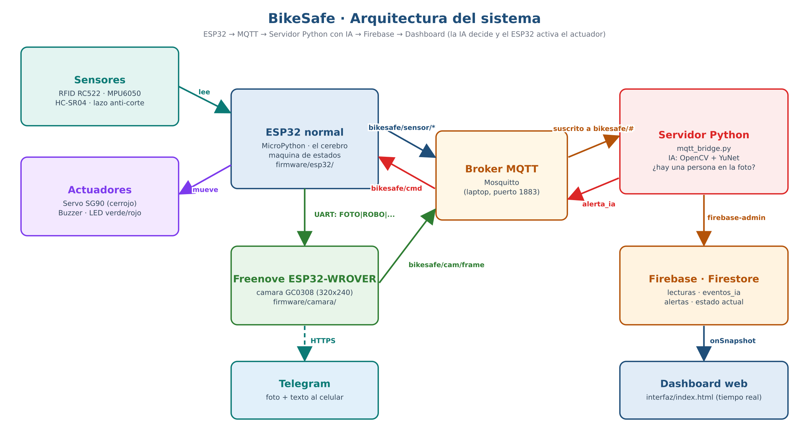

# BikeSafe — Candado inteligente portátil para bicicletas


> **Semestre:** ago-dic-2026
> **Materia:** Sistemas Programables — ISC TecNM León
> **Equipo:** 13
> **Integrantes:**

| Nombre | Matrícula | Rol | GitHub |
|--------|-----------|-----|--------|
| Oscar Sandoval Cabrera | 23240457 | 🔧 Firmware ESP32 · 🧠 Servidor Python/IA · ☁️ Firebase/Interfaz | @Sand027 |
| Diego Josué Talamantes Santiago | 23240355 | 🔩 Hardware/Carcasa · 📝 Documentación | @usuario |

---

## 📌 Descripción General

BikeSafe es un candado inteligente portátil que el ciclista lleva en la mochila y coloca en cualquier bici-estacionamiento.
Detecta intentos de manipulación o robo de la bicicleta y avisa al dueño en tiempo real mediante MQTT y Firebase.
A diferencia de un candado tradicional, combina sensores, una cámara ESP32-CAM con visión por computadora y alertas al celular.

---

## 🏗️ Arquitectura del Sistema



### Tópicos MQTT

| Tópico | Dirección | Descripción |
|--------|-----------|-------------|
| `bikesafe/s1` | ESP32 → Broker | Lectura sensor 1 |
| `bikesafe/s2` | ESP32 → Broker | Lectura sensor 2 |
| `bikesafe/s3` | ESP32 → Broker | Lectura sensor 3 |
| `bikesafe/cam/frame` | ESP32-CAM → Broker | Frame de cámara (JPEG) |
| `bikesafe/a1/cmd` | Broker → ESP32 | Comando actuador 1 |
| `bikesafe/a2/cmd` | Broker → ESP32 | Comando actuador 2 |
| `bikesafe/a3/cmd` | Broker → ESP32 | Comando actuador 3 |

---

## 📋 HAL — Hardware Abstraction Layer

| # | Componente | Tipo | Pin ESP32 | Tópico MQTT | Unidad | Rango válido |
|---|-----------|------|-----------|-------------|--------|-------------|
| 1 | _Sensor 1_ | Sensor | GPIO__ | bikesafe/s1 | | |
| 2 | _Sensor 2_ | Sensor | GPIO__ | bikesafe/s2 | | |
| 3 | _Sensor 3_ | Sensor | GPIO__ | bikesafe/s3 | | |
| 4 | _Actuador 1_ | Actuador | GPIO__ | bikesafe/a1/cmd | | |
| 5 | _Actuador 2_ | Actuador | GPIO__ | bikesafe/a2/cmd | | |
| 6 | _Actuador 3_ | Actuador | GPIO__ | bikesafe/a3/cmd | | |
| 7 | ESP32-CAM | Cámara | — | bikesafe/cam/frame | JPEG | — |

---

## 💻 Software y Firmware

```bash
pip install -r servidor/requirements.txt
```

1. Levantar el broker MQTT: `mosquitto`
2. Cargar `firmware/` en la ESP32 con Thonny.
3. Ejecutar el servidor: `cd servidor` → `python mqtt_bridge.py`

---

## 🧠 Inteligencia Artificial

- **Modelo:** _(OpenCV / MediaPipe — Sprint 2)_
- **Qué detecta:** _(pendiente)_
- **Cómo toma decisiones:** _(pendiente)_

---

## 🎥 Demostración

**Video demostrativo (YouTube):** _(pendiente — Sprint 4)_

---

## 🔥 Esquema Firebase

Ver [`firebase/esquema.md`](firebase/esquema.md).

---

## ⚠️ Retos técnicos encontrados

_(Se llena al finalizar el proyecto)_

---

*Sistemas Programables · ISC TecNM León · ago-dic-2026*
