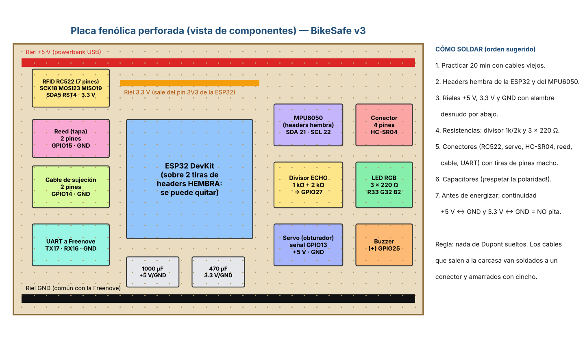

# 🔥 Guía de soldadura: de protoboard a placa perforada

> **Estado (27/nov):** por tiempo, la entrega final quedó en **protoboard fija dentro de la caja**. Esta guía es el **siguiente paso**; la lista de conexiones de abajo es la misma que usa la protoboard.

**Por qué:** en una bicicleta hay vibración constante. Un cable Dupont que se afloja en la demo apaga un sensor (o la alarma entera). En la placa fenólica todo queda **soldado, compacto y firme**.

## Material

| Qué | De dónde |
|---|---|
| Cautín + estaño | Préstamo de la maestra |
| Placa fenólica perforada | Regalo de la maestra |
| Tiras de headers **hembra** (para la ESP32 y el MPU6050) y **macho** (conectores) | Kit / papelería electrónica |
| Alambre calibre 22 (rígido) para rieles y puentes | Kit |
| Reed switch + imán chico | Compra (~$25 MXN) |
| Lector RFID RC522 | Préstamo de la maestra (soldarle los headers **con cuidado**: ver errores) |
| LED RGB y buzzer | Préstamo de la maestra |
| Cinchos (cable ties) | Ferretería |

## Lista de conexiones (netlist)

Todas las piezas comparten **GND**. La Freenove va con su propio USB, pero su GND **debe** ir al riel GND de esta placa.

| # | Desde | Hacia | Nota |
|---|---|---|---|
| 1 | ESP32 **3V3** | Riel 3.3 V | Alimenta al MPU6050 y al RC522 |
| 2 | Powerbank **5 V** | Riel +5 V | Servo, HC-SR04 |
| 3 | ESP32 **GND** | Riel GND | |
| 4 | MPU6050 VCC / GND / SDA / SCL | 3.3 V / GND / **GPIO21** / **GPIO22** | Headers hembra |
| 5 | HC-SR04 VCC / GND / TRIG | +5 V / GND / **GPIO26** | Conector de 4 pines hacia la pared frontal |
| 6 | HC-SR04 ECHO | 1 kΩ → nodo → **GPIO27**; nodo → 2 kΩ → GND | Divisor 5 V → 3.3 V (no omitirlo) |
| 7 | Reed switch (tapa de la caja) | **GPIO15** y GND | Sin resistencia: pull-up interna. El imán va pegado en la tapa |
| 7b | RC522: 3.3V / GND | Riel **3.3 V** / GND | **Nunca a 5 V** |
| 7c | RC522: SCK / MOSI / MISO | **GPIO18** / **GPIO23** / **GPIO19** | SPI por hardware (VSPI) |
| 7d | RC522: SDA (SS) / RST | **GPIO5** / **GPIO4** | IRQ no se conecta |
| 8 | Hilo del cable de sujeción | **GPIO14** y GND | Sin resistencia: pull-up interna |
| 9 | Servo (obturador): señal (naranja) / + (rojo) / − (café) | **GPIO13** / +5 V / GND | La pestaña tapa la ventana de la cámara |
| 10 | Buzzer (+) / (−) | **GPIO25** / GND | Directo, sin el 2N2222 |
| 11 | LED RGB: R / G / B | 220 Ω → **GPIO33** / 220 Ω → **GPIO32** / 220 Ω → **GPIO2** | Patita larga: GND (cátodo común) o 3.3 V (ánodo común) |
| 12 | ESP32 **TX2 (17)** → Freenove **GPIO33** | | Cruzados |
| 13 | ESP32 **RX2 (16)** ← Freenove **GPIO32** | | Cruzados |
| 14 | Capacitor 1000 µF | +5 V y GND | Pata corta (−) a GND |
| 15 | Capacitor 470 µF | 3.3 V y GND | Pata corta (−) a GND |

## Orden de trabajo

1. **Práctica (20 min):** soldar 10 uniones con cables viejos. Una buena unión es brillante, en forma de cono, y el cable no se mueve al jalarlo.
2. **Headers hembra** para la ESP32 y el MPU6050. Así las placas se pueden quitar sin desoldar.
3. **Rieles** de +5 V, 3.3 V y GND con alambre desnudo por la cara de abajo.
4. **Resistencias:** el divisor 1 kΩ/2 kΩ y las 3 de 220 Ω del LED RGB.
5. **Conectores** (tiras macho) para todo lo que sale a la carcasa: servo, HC-SR04, RC522, reed, cable de sujeción y UART. El RC522 va pegado por dentro de la pared, a menos de 3 cm de donde se pasa la tarjeta (el PETG no estorba).
6. **Capacitores,** respetando la polaridad.
7. **Revisión con multímetro antes de conectar la energía:**
   - continuidad +5 V ↔ GND → **no debe pitar** (si pita hay un corto, como el que tuvimos con el RFID);
   - continuidad 3.3 V ↔ GND → **no debe pitar**;
   - continuidad de cada GPIO a su conector → **sí debe pitar**.
8. Correr las pruebas de `firmware/pruebas/`: `e10_rfid.py` (debe salir la versión `0x92`/`0x91`/`0xB2` y el UID de la tarjeta; si sale `0x00`/`0xFF`, correr `diag_rfid.py`), `e13_led_rgb.py`, `e14_tapa_reed.py`, `e02_servo.py`, `e03_mpu6050.py`, `e09_ultrasonico.py`, `e08_buzzer.py` y `e11_lazo.py`.

## Errores que hay que evitar

- **Puentes de estaño** entre pines vecinos. Revisar con lupa (o la cámara del celular) cada fila de la ESP32 **y del RC522**: así se dañó el primer lector.
- Calentar el **reed switch** mucho tiempo o doblarlo pegado al vidrio, porque se estrella. Hay que doblar sus patitas a 3 mm del cuerpo.
- Dejar el cautín sin estaño en la punta, porque se oxida y deja de pegar.
- Soldar con la placa **energizada**. Siempre se suelda desconectado.
