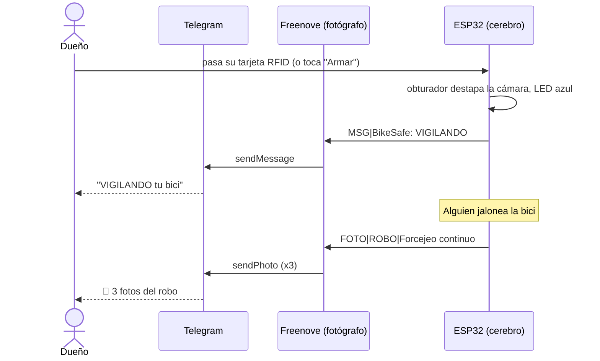

# 📱 Interfaz: bot de Telegram de BikeSafe

El dueño controla el sistema de vigilancia con un **bot de Telegram**, que es el **componente no convencional** del proyecto: no hay que instalar ninguna app propia, solo usar Telegram, que ya tiene en el celular. Además, el bot sustituye en el día a día al RFID, porque permite armar y desarmar a distancia.

Hay otras dos interfaces:
- **La tarjeta RFID**, que se pasa frente a la caja para armar o desarmar.
- **El [dashboard web](index.html)**, con el historial de Firebase y lo que decidió la IA.

## Botones

```
[  Armar  ]  [ Desarmar ]
[  Foto   ]  [  Estado  ]
[ Buscar  ]  [ Silenciar]
```

| Botón | Respuesta del bot |
|---|---|
| Armar | "🛡 BikeSafe: VIGILANDO tu bici" (o "ya estaba vigilando"). Si la tapa de la caja está abierta, contesta "⛔ NO armé…" |
| Desarmar | Pregunta "¿Seguro que quieres DESARMAR la vigilancia?" con los botones **Sí, desarmar** / **No**. La confirmación dura 30 s |
| Foto | 📷 Foto de ese momento. Si estaba desarmado, el obturador destapa la cámara 6 s y la vuelve a tapar |
| Estado | Resumen: estado, cámara (tapada o destapada), tapa de la caja, cable de sujeción, distancia, inclinación, última IA, RFID, conexión del dashboard, avisos y robos |
| Buscar | "Sonando 5 segundos para que la encuentres" |
| Silenciar | "Alarma silenciada, sigo vigilando" |

También acepta los comandos **escritos**, con o sin "/" y en mayúsculas o minúsculas (`armar`, `/Armar`, `ARMAR`).

## Alertas que llegan solas

| Emoji | Alerta | Cuándo |
|---|---|---|
| ⚠️ | AVISO: Movimiento (1 de 4) | Un toque a la bici |
| ⚠️ | AVISO: Tarjeta desconocida 4F2A9C11 | Alguien pasó una tarjeta que no es del dueño |
| 👀 | PRESENCIA: Alguien a 20 cm | Alguien parado junto a la bici |
| 🚨 | ROBO: Forcejeo / Bici inclinada / Abrieron la caja / Cable cortado / 3 tarjetas desconocidas | Intento de robo (3 fotos) |
| 🤖 | La IA confirmó una PERSONA junto a tu bici (58 %) | El servidor informó "persona" y **la ESP32 decidió** que es aviso (con 2 personas y la bici movida pasa a ROBO) |
| 👋 | DESARMADO (desde dashboard) | Alguien del equipo desarmó desde el dashboard |
| ⚠️ | Alguien más (chat 123) intentó usar tu bot | Un extraño le escribió al bot (se avisa una vez por chat) |

## Cómo funciona por dentro



**Protocolo UART** entre placas (texto, un renglón por mensaje, 9600 baudios):

| Dirección | Mensaje | Significado |
|---|---|---|
| ESP32 → Freenove | `FOTO\|nivel\|motivo` | Tomar foto y mandarla |
| ESP32 → Freenove | `MSG\|texto` | Mandar texto (`~` = salto de línea) |
| Freenove → ESP32 | `CMD\|armar` / `desarmar` / `silenciar` / `estado` / `buscar` / `foto` | Botón del bot |
| Freenove → ESP32 | `OK\|...` / `ERR\|...` | Resultado de cada orden |

## Seguridad y privacidad

- Solo se obedecen los mensajes del `TELEGRAM_CHAT_ID` configurado. Si un extraño escribe, se le avisa al dueño.
- "Desarmar" siempre pide confirmación.
- Las fotos viajan a Telegram por **HTTPS**, y al servidor de IA **cifradas** (ver el README).
- El token y la contraseña del WiFi **no están en este repositorio**.
